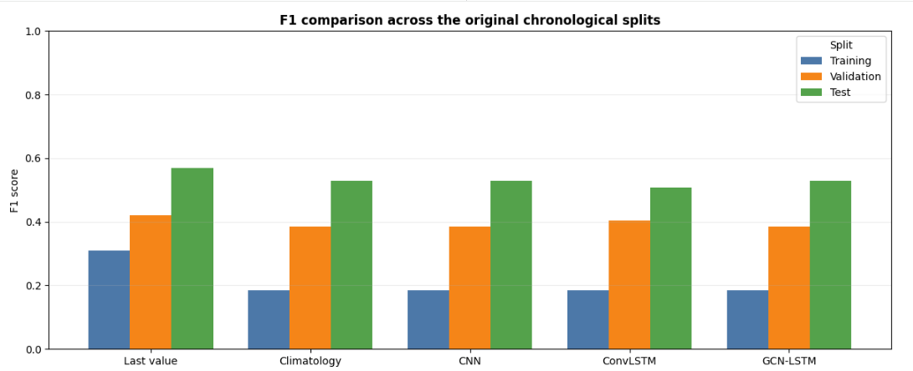
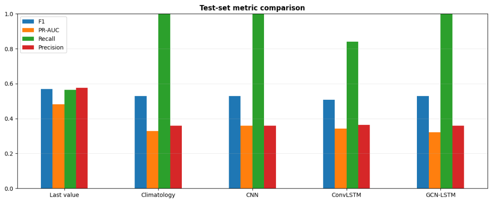
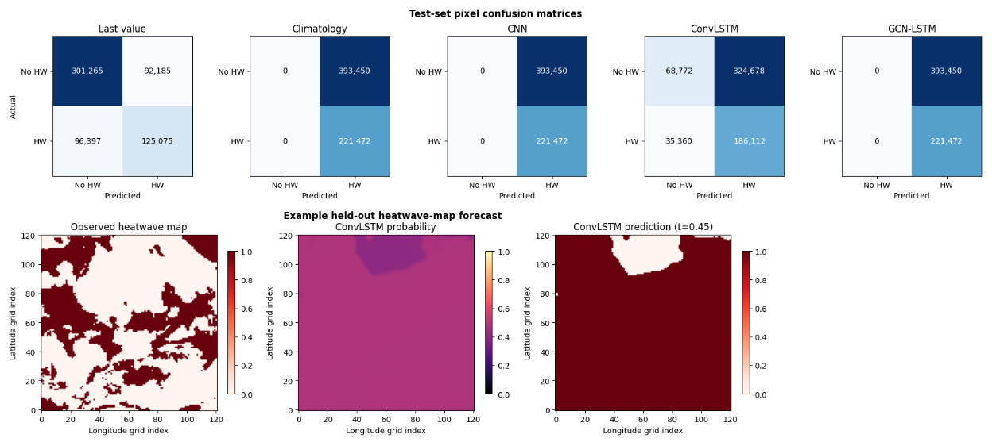
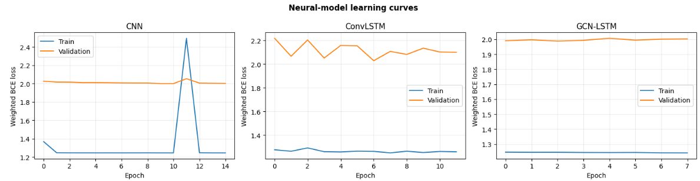

# Explainable AI for Climate Extremes: Heatwave Forecasting over India with ERA5

Predicting extreme-heat maps over the Indian region from a short history of ERA5 meteorological fields. Five approaches are compared (two naive baselines and three neural networks: CNN, ConvLSTM, GCN-LSTM) as the forecasting stage of a larger **explainable AI framework for climate-extreme prediction**.

[](https://colab.research.google.com/github/iitianpriyanshu2006-blip/Era5-heatwave-forecasting/blob/main/notebooks/Heatwave_Forecasting_Using_ERA5_dataset.ipynb)


> **Status: work in progress.** After fixing a data-alignment bug (see [Known issues](#known-issues-and-status)), the first clean benchmark shows that none of the deep models beats a simple persistence baseline at monthly resolution. The causes are diagnosed below, and the next steps (stationary labels, daily data) are on the [roadmap](#roadmap). The explainability stage (SHAP and LIME) is planned and will be applied once a model shows real skill.

---

## Motivation

Climate change is increasing the frequency and intensity of extremes such as heatwaves, floods, droughts and cyclones. Accurate prediction matters for disaster management, agriculture, water planning and public safety. Machine learning and deep learning capture the nonlinear relationships among atmospheric variables well, but most models are **black boxes**: forecasters and decision-makers cannot see *why* a warning is issued, which limits trust.

**Problem statement.** Existing AI models can predict climate extremes effectively, but their lack of interpretability makes the predictions hard to understand, trust and act on in critical decisions.

### Why explainability matters (illustrative example)

| Without XAI | With XAI |
|---|---|
| "Extreme wildlife risk in Region X tomorrow." Is it the wind, a long drought, or a model glitch? Is that enough to evacuate a city? | "Extreme wildlife risk in Region X tomorrow, because soil moisture is 80% below normal and wind speed is 40% above normal." |

### Research gaps addressed

- Lack of explainability in existing AI forecasting models
- Limited stakeholder trust in opaque predictions
- Event-specific models: a need for a unified framework covering multiple extremes (heatwaves, floods, droughts)
- Few user-friendly explanation systems and interpretable dashboards

### Objectives

1. Develop an explainable AI framework for climate-extreme prediction
2. Collect and preprocess historical climate datasets
3. Build ML / deep-learning models for predicting extreme events
4. Integrate explainability techniques (SHAP and LIME)
5. Support disaster management and climate-related decision-making

### Proposed framework

```
Climate data → Preprocessing → Feature engineering → ML/DL model → Prediction → XAI module → Explanation
```

This repository currently implements everything up to **Prediction** for heatwaves. The XAI module and other extremes are on the [roadmap](#roadmap).

## Task

| | |
|---|---|
| **Input** | 7 consecutive time steps of 5 variables on a 121 x 121 grid |
| **Output** | Probability map (121 x 121) of an extreme-heat event at the next time step |
| **Problem type** | Pixel-wise binary classification; event frequency is 10.2% in training, 23.8% in validation and 36.0% in test (see Results) |

## Data

| Item | Details |
|---|---|
| Source | ERA5 reanalysis (ECMWF / Copernicus), monthly-mean fields in NetCDF |
| Region | 7°N to 37°N, 68°E to 98°E at 0.25° resolution (121 x 121 grid) |
| Period | January 1998 to December 2024 (324 monthly steps) |
| Variables | 2 m temperature, relative humidity, mean sea-level pressure, total precipitation, 10 m wind speed (derived from u10 and v10) |
| Planned | SMAP soil moisture, as an additional predictor and for explanations |

The raw `.nc` files are too large for GitHub and are not included. They can be downloaded from the [Copernicus Climate Data Store](https://cds.climate.copernicus.eu/).

## Method

1. **Load and align** the five variable files, snapping every timestamp to the first day of its month and keeping only months present in all files (inner join). No imputation is used.
2. **Label.** A grid cell is marked as an extreme-heat event when its temperature exceeds the 90th percentile for that grid cell and calendar month, computed on the **training period only**.
3. **Chronological split:** 70% train, 15% validation, 15% test, with no shuffling across time.
4. **Sequences.** A 7-step window of the 5 variables is used to predict the next step.
5. **Normalization.** Per-variable mean and standard deviation from the training set only.
6. **Training.** Class-weighted binary cross-entropy, AdamW (learning rate 1e-3, weight decay 1e-4), ReduceLROnPlateau, early stopping (patience 5, at most 20 epochs), fixed seed 42.
7. **Thresholding.** Each model's decision threshold is tuned on the validation set (best F1 over 0.05 to 0.95) and then frozen for the test set.
8. **Evaluation.** Accuracy, precision, recall, F1, PR-AUC and ROC-AUC. Accuracy alone is misleading here because event pixels are rare.

### Models

| Model | Description |
|---|---|
| Last value | Persistence baseline: the previous label map is the forecast |
| Climatology | Per-cell event frequency from the training set |
| CNN | Map-output adaptation of the 12x12 / 9x9 heatwave CNN of Jacques-Dumas et al. (2022) |
| ConvLSTM | Three stacked 3x3 ConvLSTM cells with 60 hidden channels, following Pellicer-Valero et al. (2025) |
| GCN-LSTM | Two shared 8-neighbour grid graph-convolution layers per time step, followed by a per-cell LSTM, so spatial dependence between neighbouring cells is modelled explicitly |

### Planned explainability

- **SHAP** (Lundberg and Lee, 2017) for global and per-prediction feature importance
- **LIME** (Ribeiro et al., 2016) for local explanations of individual predictions
- Feature-importance visualizations and an interpretable decision-support view

## Results

Run with the corrected pipeline: 324 monthly steps, no missing values, 42 test sequences (614,922 test pixels). Thresholds are tuned on validation only.

**Reference point:** a trivial classifier that predicts "event" everywhere scores F1 = 0.186 / 0.385 / 0.530 on train / validation / test, because those are the event frequencies. A model has skill only if it beats this.

### Test-set metrics

| Model | Accuracy | Precision | Recall | F1 | PR-AUC | ROC-AUC | Threshold |
|---|---|---|---|---|---|---|---|
| Last value (persistence) | 0.6933 | 0.5757 | 0.5647 | **0.5702** | 0.4819 | 0.6652 | 0.50 |
| Climatology | 0.3602 | 0.3602 | 1.0000 | 0.5296 | 0.3289 | 0.4398 | 0.05 |
| CNN | 0.3602 | 0.3602 | 1.0000 | 0.5296 | 0.3602 | 0.5000 | 0.05 |
| GCN-LSTM | 0.3602 | 0.3602 | 1.0000 | 0.5296 | 0.3210 | 0.4394 | 0.05 |
| ConvLSTM | 0.4145 | 0.3644 | 0.8403 | 0.5083 | 0.3421 | 0.4954 | 0.45 |




### Test-set confusion matrices (pixel counts)

| Model | True negative | False positive | False negative | True positive |
|---|---|---|---|---|
| Last value | 301,265 | 92,185 | 96,397 | 125,075 |
| Climatology | 0 | 393,450 | 0 | 221,472 |
| CNN | 0 | 393,450 | 0 | 221,472 |
| ConvLSTM | 68,772 | 324,678 | 35,360 | 186,112 |
| GCN-LSTM | 0 | 393,450 | 0 | 221,472 |



### Findings

1. **Persistence is the only method with real skill.** Last value reaches F1 0.570 and ROC-AUC 0.665, above the trivial 0.530. Anomalies persist from month to month.
2. **Climatology, CNN and GCN-LSTM collapsed to "event everywhere".** Their F1 of 0.5296 equals the trivial classifier exactly, and their ROC-AUC (0.44 to 0.50) shows no ranking skill. ConvLSTM is only partly collapsed and scores below the trivial value.
3. **The networks are not learning.** Training loss is flat from the first epoch and validation loss does not improve (below), and the ConvLSTM probability map is almost uniform.
4. **The event rate shifts strongly over time.** The label is the 90th percentile of the training period, and the event frequency rises from 10.2% (training, 1998 to 2016) to 23.8% (validation) and 36.0% (test). This is consistent with a warming climate. Climatology's test ROC-AUC below 0.5 shows that past spatial patterns do not carry over.
5. **Why the models likely fail (hypotheses to test):** only about 226 training sequences for models with many parameters; the shifted validation set pushes threshold selection to "predict everything"; class weights were set for a 10% event rate; and the monthly resolution is coarse.



> **Note on an earlier run.** A first run on the misaligned data reported GCN-LSTM F1 = 0.68. That was an artifact of constant filler maps and is not reproduced here.

## Known issues and status

| Issue | Effect | Status |
|---|---|---|
| Source files had different timestamps for the same month, so the merge produced 972 steps instead of 324 | 66.7% of every variable was NaN | **Fixed.** Timestamps snapped to month start, inner join, 324 steps, no NaNs |
| NaNs were filled with the global mean | Two thirds of input maps were constant, inflating scores | **Fixed.** No imputation |
| Single global 95th-percentile label computed on all data | Marked permanently hot regions and leaked test data | **Fixed.** Per-cell, per-calendar-month threshold from training years only |
| Label is not stationary | Event rate 10% to 24% to 36% across splits; thresholds and class weights do not transfer | **Open.** See roadmap |
| Monthly means and about 226 training sequences | Too little data for deep models; monthly means cannot represent multi-day heatwaves | **Open.** Move to daily data |

## Roadmap

- [x] Diagnose and fix the time-alignment and imputation problem
- [x] Re-run all five models with the corrected pipeline
- [ ] Make the label stationary (for example a percentile from a fixed reference climatology, or detrended anomalies) so event frequency is comparable across splits
- [ ] Move to daily ERA5 (daily maximum 2 m temperature) for far more training samples, with an operational heatwave definition (for example IMD criteria or at least 3 consecutive days above a local percentile)
- [ ] Fix the model collapse: smaller or more regularized networks, seasonal cycle and persistence as extra inputs, anomaly targets
- [ ] Multiple random seeds with confidence intervals
- [ ] Add SHAP and LIME explanations once a model clearly beats the persistence baseline
- [ ] Add SMAP soil moisture as a predictor
- [ ] Extend the framework to other extremes (droughts, floods)

## Potential applications

Early-warning and disaster management, crop planning and irrigation, reservoir operation and drought monitoring, climate-resilient urban planning, evidence-based adaptation policy, and insurance risk assessment.

## Repository structure

```
Era5-heatwave-forecasting/
├── README.md
├── notebooks/
│   └── Heatwave_Forecasting_Using_ERA5_dataset.ipynb
├── src/
│   └── corrected_preprocessing_cells.py
├── presentation/
│   └── Priyanshu_NITD_mainppt.pptx
├── images/                 (result plots)
└── requirements.txt
```

## How to run

1. Open the notebook in Google Colab with the badge above and select a GPU runtime.
2. Put the ERA5 NetCDF files in Google Drive and update the paths in the first cells.
3. Use the functions in `src/corrected_preprocessing_cells.py` for loading, alignment and labelling, in place of the original merge, imputation and label cells.
4. Run all cells from top to bottom.

Main libraries: `xarray`, `netCDF4`, `numpy`, `pandas`, `scikit-learn`, `torch`, `matplotlib`.

## References

- Ribeiro, M. T., Singh, S., and Guestrin, C. (2016). "Why should I trust you?": Explaining the predictions of any classifier (LIME). *Proceedings of KDD 2016.*
- Lundberg, S. M., and Lee, S.-I. (2017). A unified approach to interpreting model predictions (SHAP). *Advances in Neural Information Processing Systems 30.*
- Jacques-Dumas, V., et al. (2022). *Deep neural networks to predict heatwaves.* https://doi.org/10.3389/fclim.2022.789641
- Pellicer-Valero, O. J., et al. (2025). *Explainable Earth Surface Forecasting Under Extreme Events.* https://doi.org/10.1029/2024EF005446
- Hersbach, H., et al. (2020). The ERA5 global reanalysis. *Quarterly Journal of the Royal Meteorological Society*, 146, 1999-2049.

## Author

**Priyanshu Raj**, Department of Computer Science and Engineering, Indian Institute of Technology, Patna.

Contact: priyanshuraj767761@gmail.com · [GitHub](https://github.com/iitianpriyanshu2006-blip)
